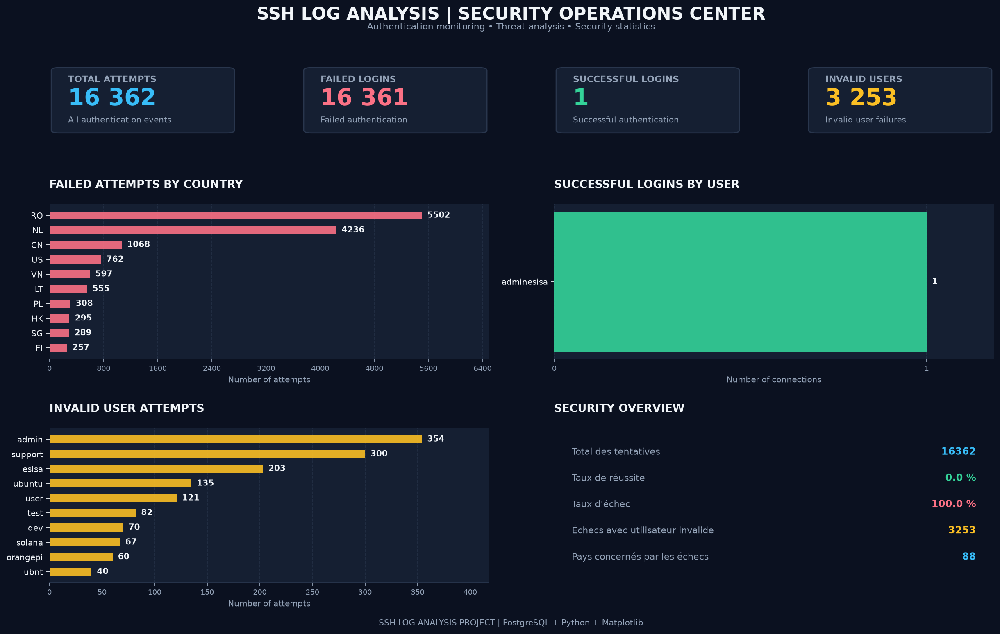

# Pipeline log analyser

Projet Python avancé : analyse des tentatives de connexion SSH à partir des fichiers
`auth.log` d'un serveur, avec géolocalisation des adresses IP, sauvegarde dans PostgreSQL
et dashboard.

**Auteur :** [TON NOM]

---

## 1. Objectif

Les fichiers `auth.log` d'un serveur contiennent toutes les tentatives de connexion SSH.
Ce pipeline les lit, en extrait les tentatives réussies et échouées, trouve le pays
d'origine de chaque adresse IP, enregistre le résultat dans une base PostgreSQL et
affiche un dashboard avec trois indicateurs :

1. le nombre de tentatives échouées par pays ;
2. le nombre de tentatives réussies par utilisateur ;
3. les tentatives échouées avec un utilisateur invalide (`invalid user`).

## 2. Structure du projet

```
logs_analysis/
├── main.py                    point d'entrée : enchaîne toutes les étapes
├── pyproject.toml             dépendances (matplotlib, requests, psycopg2-binary)
├── data/                      logs bruts (auth.log.1, auth.log.2, auth.log.3.gz, auth.log.4.gz)
├── utils/logger.py            configuration des logs (un fichier par module)
├── ingestion/read.py          lecture des fichiers texte et .gz
├── processing/
│   ├── extract_transform.py   extraction des événements avec des regex
│   ├── geolocation.py         pays d'une IP via ipinfo.io (avec cache)
│   └── analysis.py            calcul des statistiques
├── database/db.py             sauvegarde dans PostgreSQL
├── dashboard/dashboard.py     graphiques matplotlib
├── cache/geo_cache.json       cache des pays déjà trouvés (créé par le programme)
├── output/dashboard.png       dashboard généré
└── logs/                      journaux de l'application (un fichier par module)
```

## 3. Installation

**Prérequis :** Python 3.12 ou plus, PostgreSQL, et un compte gratuit sur
[ipinfo.io](https://ipinfo.io) pour obtenir un token.

```bash
python -m venv .venv
.venv\Scripts\activate          # Windows
pip install matplotlib requests psycopg2-binary
```

Créer la base de données (dans pgAdmin ou `psql`) :

```sql
CREATE DATABASE log_analysis;
```

## 4. Configuration

Les secrets ne sont jamais écrits dans le code : ils sont lus dans des variables
d'environnement.

| Variable | Rôle | Défaut |
|---|---|---|
| `IPINFO_TOKEN` | Token ipinfo.io (évite la limite de requêtes) | aucun |
| `DB_PASSWORD` | Mot de passe PostgreSQL (**obligatoire** pour la base) | aucun |
| `DB_HOST` | Serveur PostgreSQL | `localhost` |
| `DB_PORT` | Port | `5432` |
| `DB_NAME` | Nom de la base | `log_analysis` |
| `DB_USER` | Utilisateur | `postgres` |

Exemple sous PowerShell :

```powershell
$env:IPINFO_TOKEN="mon_token"
$env:DB_PASSWORD="mon_mot_de_passe"
```

## 5. Exécution

```bash
python main.py
```
pour postgrisql:
    "$env:PGPORT="5000""
    "psql -U postgres -d log_analysis "
    
Une fenêtre avec le dashboard s'ouvre et l'image est enregistrée dans
`output/dashboard.png`. Fermer la fenêtre pour terminer le programme.

## 6. Étapes du pipeline

1. **Ingestion** (`ingestion/read.py`) : lecture de tous les fichiers `auth.log*` du
   dossier `data/`, qu'ils soient en texte ou compressés en `.gz`. Résultat :
   65 565 lignes.
2. **Extraction** (`processing/extract_transform.py`) : une expression régulière
   transforme chaque ligne d'authentification en dictionnaire (date, statut, utilisateur,
   IP, port, `invalid user` ou non, nombre de tentatives).
3. **Géolocalisation** (`processing/geolocation.py`) : le pays de chaque IP à l'origine
   d'un échec est demandé à ipinfo.io avec `requests`. Les résultats sont gardés dans
   `cache/geo_cache.json` pour ne pas redemander la même IP.
4. **Statistiques** (`processing/analysis.py`) : trois compteurs (`Counter`) pour les
   trois indicateurs du dashboard.
5. **Base de données** (`database/db.py`) : enregistrement des événements dans la table
   `auth_events` de PostgreSQL.
6. **Dashboard** (`dashboard/dashboard.py`) : quatre panneaux matplotlib (les trois
   indicateurs et les chiffres clés).

## 7. Base de données

Les événements sont enregistrés dans la table `auth_events` de PostgreSQL (base
`log_analysis`). Une ligne de la table correspond à **une tentative** :

| Colonne | Type | Contenu |
|---|---|---|
| `id` | bigserial | identifiant |
| `month`, `day`, `log_time` | varchar(3), smallint, time | date et heure de la ligne (les logs n'ont pas d'année) |
| `event_type` | varchar(10) | `failed` ou `success` |
| `method` | varchar(30) | `password`, `none`... |
| `username` | text | nom d'utilisateur essayé |
| `ip` | inet | adresse IP source |
| `country` | text | pays de l'IP |
| `invalid_user` | boolean | vrai si la ligne contient « invalid user » |

Une ligne de log « message repeated N times » est enregistrée N fois, pour que le nombre
de lignes de la table soit égal au nombre de tentatives (16 361 échecs et 1 succès).

À chaque exécution, la table est vidée puis rechargée dans une seule transaction : pas de
doublons, et si une erreur survient rien n'est modifié. Le programme vérifie ensuite que le
nombre de lignes en base correspond à celui calculé en mémoire.

Exemple de requête (échecs avec `invalid user`) :

```sql
SELECT username, COUNT(*) AS tentatives
FROM auth_events
WHERE event_type = 'failed' AND invalid_user = TRUE
GROUP BY username
ORDER BY tentatives DESC
LIMIT 10;
```

## 8. Gestion des logs et des erreurs

Chaque module écrit dans son propre fichier du dossier `logs/` (`ingestion.log`,
`extract_transform.log`, `geolocation.log`, `analysis.log`, `database.log`,
`dashboard.log`, `main.log`), avec rotation à 1 Mo (`RotatingFileHandler`).

Erreurs gérées, par module :

- **ingestion** : dossier ou fichier introuvable, permission refusée, `.gz` corrompu ou
  tronqué. Un fichier cassé n'empêche pas la lecture des autres.
- **extract_transform** : ligne d'authentification au format inattendu (signalée en
  WARNING), ligne invalide, port illisible.
- **geolocation** : timeout, connexion impossible, limite de requêtes (HTTP 429), erreur
  HTTP (403...), réponse non JSON, cache illisible. Après une limite de requêtes ou
  5 erreurs de suite, les requêtes s'arrêtent et les IP restantes sont classées
  « Inconnu ».
- **database** : mot de passe absent, serveur inaccessible, erreur SQL (transaction
  annulée). Si la base est indisponible, le reste du pipeline continue.
- **dashboard** : absence de données, erreur d'enregistrement de l'image.

## 9. Résultats

> À COMPLÉTER avec tes propres résultats, après avoir lancé le programme.

- Lignes lues : 65 565
- Tentatives échouées : 16 361
- Tentatives réussies : 1 (utilisateur `adminesisa`)
- Échecs avec `invalid user` : 3 253
- Pays les plus à l'origine des échecs : [À COMPLÉTER]
- Noms d'utilisateur invalides les plus tentés : `admin`, `support`, `esisa`, `ubuntu`, `user`



Observations : [À COMPLÉTER avec tes mots : que remarques-tu sur les pays, sur les noms
d'utilisateur essayés ?]

## 10. Choix et limites

- **« message repeated N times »** : quand une tentative se répète, le système n'écrit
  qu'une ligne. Elle est comptée N fois (champ `attempts`), sinon le nombre d'échecs serait
  sous-estimé.
- **Définition de « invalid user »** : on compte les lignes `Failed ... for invalid user X`
  (échecs d'authentification sur un utilisateur qui n'existe pas).
- **Échec** : les lignes `Failed password` et `Failed none` sont comptées comme des échecs.
- **Une seule connexion réussie** dans les logs, donc le graphique « réussies par
  utilisateur » n'a qu'une barre.
- **Pas d'année** dans les logs : seuls le mois, le jour et l'heure sont conservés.
- **Adresses IPv6** : non gérées par l'expression régulière (aucune dans ces logs ; le
  programme les signalerait en WARNING).
- **Géolocalisation** : dépend d'une API externe limitée en nombre de requêtes. Une IP sans
  pays trouvé est classée « Inconnu ». Les IP privées (ex. `10.x.x.x`) sont classées
  « Réseau privé ».
- **Packages** : uniquement ceux vus en cours (`re`, `logging`, `gzip`, `requests`,
  `matplotlib`, `psycopg2`) et la bibliothèque standard.